

<picture><source media="(prefers-color-scheme: dark)" srcset="assets/hero/hero-dark.svg"><source media="(prefers-color-scheme: light)" srcset="assets/hero/hero-light.svg">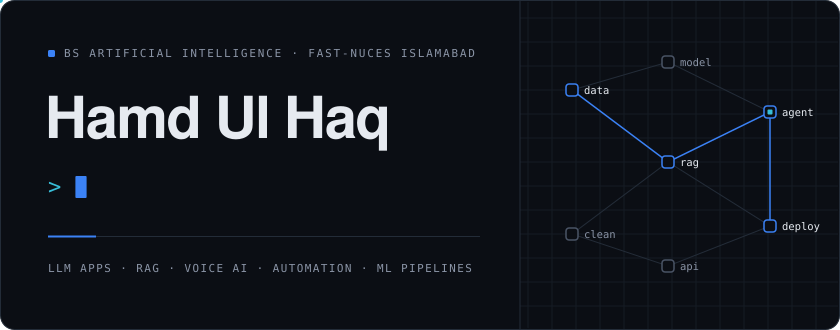</picture>

 

**AI undergraduate at FAST-NUCES Islamabad building LLM applications, voice and RAG assistants, automated data pipelines and deep-learning models, from data collection to deployment.**

 

<a href="https://linkedin.com/in/hamdulhaq/"><picture><source media="(prefers-color-scheme: dark)" srcset="assets/buttons/linkedin-dark.svg"><source media="(prefers-color-scheme: light)" srcset="assets/buttons/linkedin-light.svg"></picture></a>&nbsp;
<a href="https://github.com/hamdulhaq27"><picture><source media="(prefers-color-scheme: dark)" srcset="assets/buttons/github-dark.svg"><source media="(prefers-color-scheme: light)" srcset="assets/buttons/github-light.svg"></picture></a>

 

<picture><source media="(prefers-color-scheme: dark)" srcset="assets/decorations/section-02-dark.svg"><source media="(prefers-color-scheme: light)" srcset="assets/decorations/section-02-light.svg">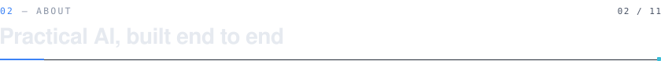</picture>

<table>
<tr>
<td width="56%" valign="top">

I'm Hamd, a third-year Artificial Intelligence undergraduate at **FAST-NUCES Islamabad**.

Most of what I build sits where models meet real systems: a local LLM assistant that takes restaurant bookings by text or voice, a pipeline that scrapes, segments and scores property listings every morning, and a queue-backed scraper that enriches business leads and runs scheduled outreach.

I like the unglamorous parts that make AI usable, extracting structured slots *before* the LLM sees a message, dedup keys that make reruns safe, subprocess pipelines that refuse to sync half-finished data, and evaluation suites that say whether any of it actually works.

</td>
<td width="44%" valign="top">

<picture><source media="(prefers-color-scheme: dark)" srcset="assets/decorations/label-focus-dark.svg"><source media="(prefers-color-scheme: light)" srcset="assets/decorations/label-focus-light.svg"></picture> 
LLM applications, RAG and voice assistants, applied ML

<picture><source media="(prefers-color-scheme: dark)" srcset="assets/decorations/label-interests-dark.svg"><source media="(prefers-color-scheme: light)" srcset="assets/decorations/label-interests-light.svg"></picture> 
Agentic AI, MLOps, computer vision

<picture><source media="(prefers-color-scheme: dark)" srcset="assets/decorations/label-approach-dark.svg"><source media="(prefers-color-scheme: light)" srcset="assets/decorations/label-approach-light.svg"></picture> 
Data collection → model → API → deployment, with evaluation in between

<picture><source media="(prefers-color-scheme: dark)" srcset="assets/decorations/label-domains-dark.svg"><source media="(prefers-color-scheme: light)" srcset="assets/decorations/label-domains-light.svg"></picture> 
NLP · deep learning · data pipelines · backend APIs

</td>
</tr>
</table>

 

<picture><source media="(prefers-color-scheme: dark)" srcset="assets/decorations/section-03-dark.svg"><source media="(prefers-color-scheme: light)" srcset="assets/decorations/section-03-light.svg"></picture>

<picture><source media="(prefers-color-scheme: dark)" srcset="assets/timeline/journey-dark.svg"><source media="(prefers-color-scheme: light)" srcset="assets/timeline/journey-light.svg">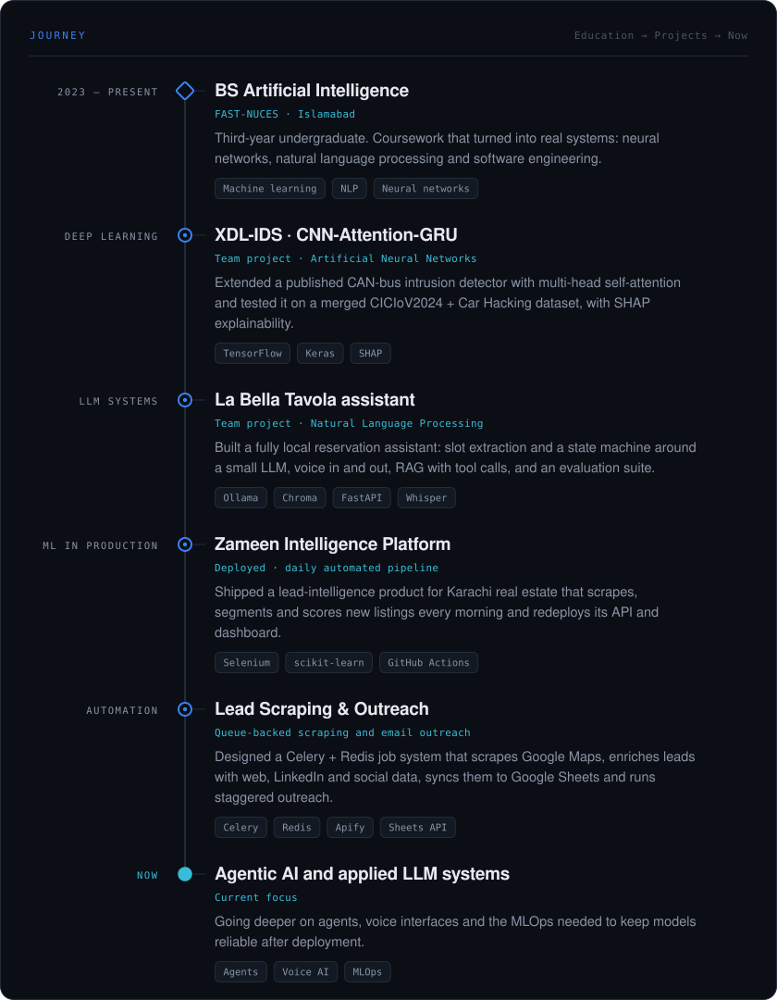</picture>

 

<picture><source media="(prefers-color-scheme: dark)" srcset="assets/decorations/section-04-dark.svg"><source media="(prefers-color-scheme: light)" srcset="assets/decorations/section-04-light.svg"></picture>

<table>
<tr>
<td width="50%" valign="top">

<picture><source media="(prefers-color-scheme: dark)" srcset="assets/capabilities/ml-dark.svg"><source media="(prefers-color-scheme: light)" srcset="assets/capabilities/ml-light.svg"></picture>

Deep-learning and classical models built around a real question: a CNN-Attention-GRU for CAN-bus intrusion detection, KMeans market segmentation and weighted lead scoring.

<code>TensorFlow</code> <code>Keras</code> <code>PyTorch</code> <code>scikit-learn</code> <code>SHAP</code>

</td>
<td width="50%" valign="top">

<picture><source media="(prefers-color-scheme: dark)" srcset="assets/capabilities/llm-dark.svg"><source media="(prefers-color-scheme: light)" srcset="assets/capabilities/llm-light.svg"></picture>

Assistants that stay on task: state machines and slot memory around local models, Chroma retrieval, tool calls into CRM and SQLite, and streamed responses.

<code>Ollama</code> <code>Qwen</code> <code>Chroma</code> <code>sentence-transformers</code> <code>LangChain</code>

</td>
</tr>
<tr>
<td width="50%" valign="top">

<picture><source media="(prefers-color-scheme: dark)" srcset="assets/capabilities/automation-dark.svg"><source media="(prefers-color-scheme: light)" srcset="assets/capabilities/automation-light.svg"></picture>

Jobs that run on a schedule or a queue: daily cron pipelines that commit data and trigger redeploys, and Celery tasks scheduled with `eta` and staggered countdowns.

<code>Celery</code> <code>Redis</code> <code>GitHub Actions</code> <code>Apify</code> <code>SMTP</code>

</td>
<td width="50%" valign="top">

<picture><source media="(prefers-color-scheme: dark)" srcset="assets/capabilities/backend-dark.svg"><source media="(prefers-color-scheme: light)" srcset="assets/capabilities/backend-light.svg"></picture>

FastAPI services that stay responsive: REST endpoints for dashboards, WebSocket token streaming, and servers that enqueue work and report task status instead of blocking.

<code>Python</code> <code>FastAPI</code> <code>WebSockets</code> <code>Docker</code> <code>Render</code>

</td>
</tr>
<tr>
<td width="50%" valign="top">

<picture><source media="(prefers-color-scheme: dark)" srcset="assets/capabilities/data-dark.svg"><source media="(prefers-color-scheme: light)" srcset="assets/capabilities/data-light.svg"></picture>

Getting messy web data into a usable shape: Selenium scraping, website and LinkedIn enrichment, E.164 phone normalisation, email validation and `place_id` dedupe.

<code>Selenium</code> <code>BeautifulSoup</code> <code>Pandas</code> <code>NumPy</code> <code>Sheets API</code>

</td>
<td width="50%" valign="top">

<picture><source media="(prefers-color-scheme: dark)" srcset="assets/capabilities/systems-dark.svg"><source media="(prefers-color-scheme: light)" srcset="assets/capabilities/systems-light.svg"></picture>

End-to-end systems where the model is one component: speech-to-text → LLM → text-to-speech loops, scored data behind live dashboards, and scrapers feeding outreach.

<code>Faster-Whisper</code> <code>Piper</code> <code>React</code> <code>TypeScript</code> <code>Vercel</code>

</td>
</tr>
</table>

 

<picture><source media="(prefers-color-scheme: dark)" srcset="assets/decorations/section-05-dark.svg"><source media="(prefers-color-scheme: light)" srcset="assets/decorations/section-05-light.svg">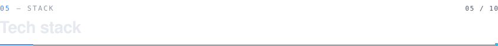</picture>

<picture><source media="(prefers-color-scheme: dark)" srcset="assets/stack/01-languages-dark.svg"><source media="(prefers-color-scheme: light)" srcset="assets/stack/01-languages-light.svg">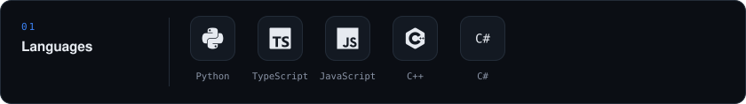</picture>
<picture><source media="(prefers-color-scheme: dark)" srcset="assets/stack/02-ai-dark.svg"><source media="(prefers-color-scheme: light)" srcset="assets/stack/02-ai-light.svg">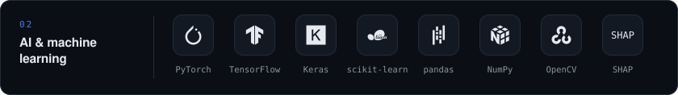</picture>
<picture><source media="(prefers-color-scheme: dark)" srcset="assets/stack/03-llms-dark.svg"><source media="(prefers-color-scheme: light)" srcset="assets/stack/03-llms-light.svg">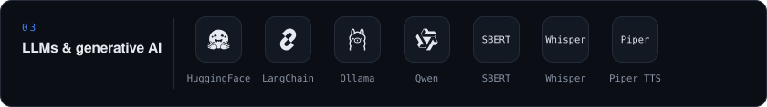</picture>
<picture><source media="(prefers-color-scheme: dark)" srcset="assets/stack/04-backend-dark.svg"><source media="(prefers-color-scheme: light)" srcset="assets/stack/04-backend-light.svg">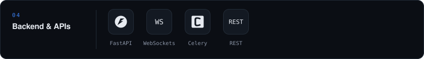</picture>
<picture><source media="(prefers-color-scheme: dark)" srcset="assets/stack/05-automation-dark.svg"><source media="(prefers-color-scheme: light)" srcset="assets/stack/05-automation-light.svg">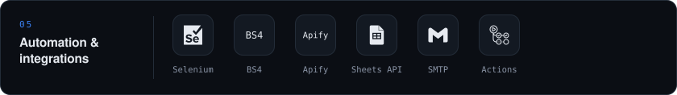</picture>
<picture><source media="(prefers-color-scheme: dark)" srcset="assets/stack/06-databases-dark.svg"><source media="(prefers-color-scheme: light)" srcset="assets/stack/06-databases-light.svg">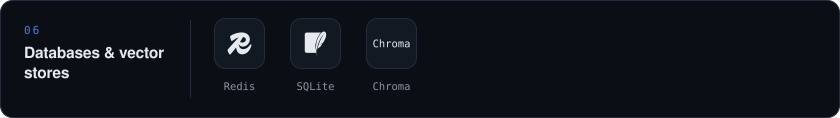</picture>
<picture><source media="(prefers-color-scheme: dark)" srcset="assets/stack/07-frontend-dark.svg"><source media="(prefers-color-scheme: light)" srcset="assets/stack/07-frontend-light.svg">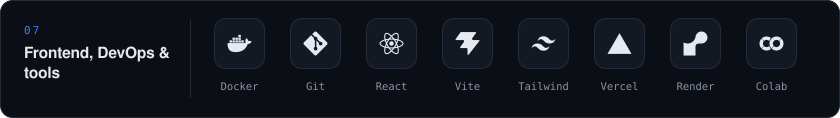</picture>

 

<picture><source media="(prefers-color-scheme: dark)" srcset="assets/decorations/section-06-dark.svg"><source media="(prefers-color-scheme: light)" srcset="assets/decorations/section-06-light.svg">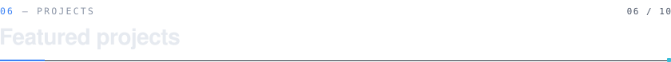</picture>

### Lead Scraping & Outreach Automation

<b>AI AUTOMATION · DATA PIPELINE</b>

<picture><source media="(prefers-color-scheme: dark)" srcset="assets/projects/lead-scraping-dark.svg"><source media="(prefers-color-scheme: light)" srcset="assets/projects/lead-scraping-light.svg">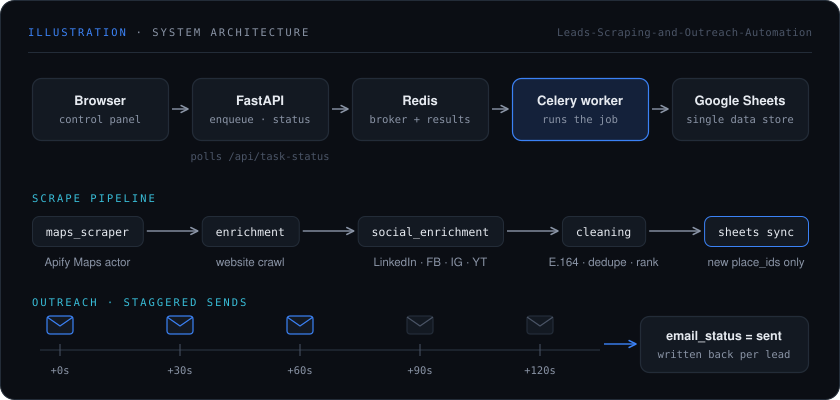</picture>

Building a B2B lead list by hand means searching Maps, visiting every website, hunting LinkedIn for decision-makers and tracking who has already been emailed. This system does it in the background: give it a business type and a location, and it scrapes Google Maps, enriches every business, syncs clean leads to Google Sheets and runs scheduled outreach.

- **Non-blocking by design**: FastAPI only enqueues jobs and returns a task ID; a Celery worker on Redis does the work while the UI polls `/api/task-status`.
- **Fail-closed pipeline**: five subprocess stages (Apify Maps actor → website crawl → LinkedIn / Facebook / Instagram / YouTube enrichment → cleaning → Sheets sync); if any stage exits non-zero, partial data never reaches the sheet.
- **Clean, deduplicated output**: phones normalised to E.164, personal vs role-based emails split, leads merged by `place_id`, top five decision-makers ranked CEO/Founder → C-suite → directors.
- **Safe scheduling**: scrapes and campaigns can be queued for an exact time with `apply_async(eta=…)`; campaigns fan out one send per lead at +0s, +30s, +60s… and write `email_status` back, so reruns never email anyone twice.

<code>Python</code> <code>FastAPI</code> <code>Celery</code> <code>Redis</code> <code>Apify</code> <code>Google Sheets API</code> <code>SMTP</code> <code>Docker</code>

<a href="https://github.com/hamdulhaq27/Leads-Scraping-and-Outreach-Automation"><picture><source media="(prefers-color-scheme: dark)" srcset="assets/buttons/repo-dark.svg"><source media="(prefers-color-scheme: light)" srcset="assets/buttons/repo-light.svg"></picture></a>

<picture><source media="(prefers-color-scheme: dark)" srcset="assets/decorations/divider-dark.svg"><source media="(prefers-color-scheme: light)" srcset="assets/decorations/divider-light.svg"></picture>

### Real Estate Lead Intelligence Platform

<b>ML PIPELINE · LIVE PRODUCT</b>

<picture><source media="(prefers-color-scheme: dark)" srcset="assets/projects/zameen-dashboard-dark.svg"><source media="(prefers-color-scheme: light)" srcset="assets/projects/zameen-dashboard-light.svg">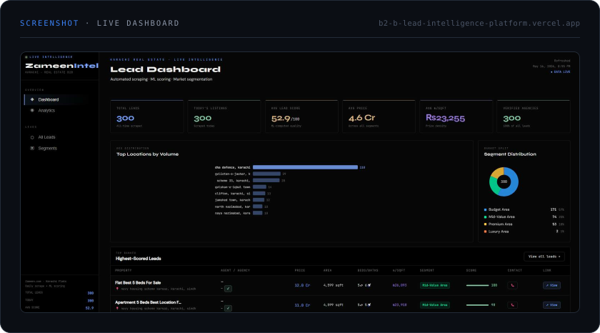</picture>

New real-estate leads in Karachi are scattered across thousands of listings, with no quick way to tell which are worth a call. Every morning at 7 AM PKT, this platform collects the day's flat listings from Zameen.com, segments the market, scores every lead and redeploys a live API and dashboard with no manual step.

- **Automated daily run**: a GitHub Actions cron job scrapes, cleans, segments and scores, commits fresh CSVs, then triggers a Render redeploy.
- **Today-only scraper**: Selenium keeps only listings posted today and visits agency profiles for phone, email and listing counts.
- **Scoring and segmentation**: a weighted 0–100 lead score (price, area, price/sqft, recency, verified agency …) and KMeans (K = 4) tiers from Budget to Luxury.
- **Product surface**: FastAPI REST API in Docker on Render, single-file dashboard on Vercel with KPIs, trends, segments and filterable leads.

<code>Python</code> <code>Selenium</code> <code>BeautifulSoup</code> <code>Pandas</code> <code>scikit-learn</code> <code>FastAPI</code> <code>Docker</code> <code>GitHub Actions</code> <code>Render</code> <code>Vercel</code>

<a href="https://github.com/hamdulhaq27/B2B-Lead-Intelligence-Platform"><picture><source media="(prefers-color-scheme: dark)" srcset="assets/buttons/repo-dark.svg"><source media="(prefers-color-scheme: light)" srcset="assets/buttons/repo-light.svg"></picture></a>&nbsp;
<a href="https://b2-b-lead-intelligence-platform.vercel.app/"><picture><source media="(prefers-color-scheme: dark)" srcset="assets/buttons/demo-dark.svg"><source media="(prefers-color-scheme: light)" srcset="assets/buttons/demo-light.svg"></picture></a>

<picture><source media="(prefers-color-scheme: dark)" srcset="assets/decorations/divider-dark.svg"><source media="(prefers-color-scheme: light)" srcset="assets/decorations/divider-light.svg"></picture>

### Conversational Reservation Assistant

<b>LLM · RAG · VOICE AI</b>

<picture><source media="(prefers-color-scheme: dark)" srcset="assets/projects/la-bella-tavola-dark.svg"><source media="(prefers-color-scheme: light)" srcset="assets/projects/la-bella-tavola-light.svg">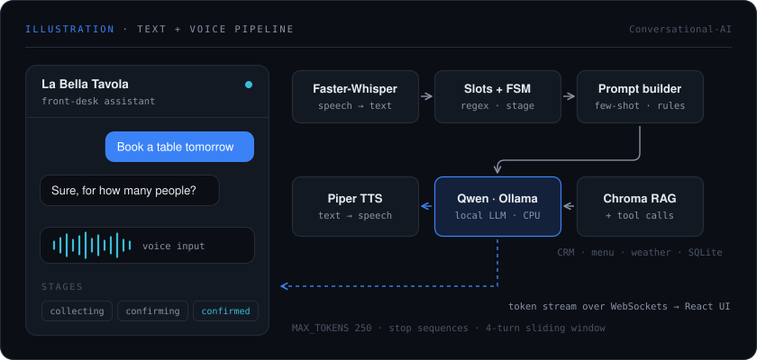</picture>

Small LLMs running on a CPU drift, hallucinate and forget booking details halfway through a conversation. This fully local front-desk assistant handles reservations, changes, cancellations and menu, weather and helpdesk questions by text or voice, by putting structure around the model instead of trusting it.

- **Structure before generation**:regex slot extraction and intent detection run first; a finite-state machine (`collecting → confirming → confirmed → modifying`) decides what is still missing.
- **Constrained local inference**:stage-specific prompts with few-shot examples, Qwen 1.8B / Qwen 2.5 3B Instruct via Ollama, `MAX_TOKENS = 250` and stop sequences, streamed token-by-token over FastAPI WebSockets to a React UI.
- **Voice loop**: Faster-Whisper speech-to-text in, Piper text-to-speech out as Base64 WAV.
- **RAG, tools and evals**: Chroma + sentence-transformers retrieval and tool calls (CRM, menu, weather, SQLite), plus an evaluation suite covering task completion, retrieval precision/recall/MRR, tool-call accuracy and latency (TTFT, p90, p99).

<code>Python</code> <code>FastAPI</code> <code>WebSockets</code> <code>Ollama</code> <code>Qwen</code> <code>Chroma</code> <code>sentence-transformers</code> <code>Faster-Whisper</code> <code>Piper</code> <code>React</code> <code>TypeScript</code> <code>Docker Compose</code>

<a href="https://github.com/hamdulhaq27/Conversational-AI"><picture><source media="(prefers-color-scheme: dark)" srcset="assets/buttons/repo-dark.svg"><source media="(prefers-color-scheme: light)" srcset="assets/buttons/repo-light.svg"></picture></a>

<picture><source media="(prefers-color-scheme: dark)" srcset="assets/decorations/divider-dark.svg"><source media="(prefers-color-scheme: light)" srcset="assets/decorations/divider-light.svg"></picture>

### CNN-Attention-GRU Intrusion Detection

<b>DEEP LEARNING · SECURITY</b>

<picture><source media="(prefers-color-scheme: dark)" srcset="assets/projects/xdl-ids-dark.svg"><source media="(prefers-color-scheme: light)" srcset="assets/projects/xdl-ids-light.svg">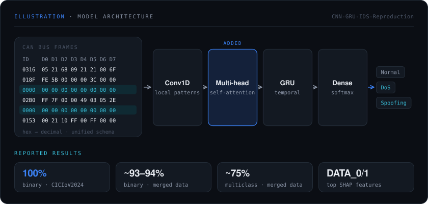</picture>

A car's CAN bus has no built-in authentication, so spoofing and denial-of-service attacks have to be spotted from message patterns alone. This project extends the published XDL-IDS CNN-GRU detector by inserting a multi-head self-attention layer, then stress-tests generalisation by merging two datasets.

- **Architecture**: Input → Conv1D → multi-head self-attention → GRU → Dense, compared against the CNN-GRU baseline.
- **Dataset expansion**: CICIoV2024 merged with the Car Hacking dataset: hex payloads to decimal, a unified `ID, DATA_0–DATA_7` schema and cross-dataset attack-label mapping.
- **Efficient training**: mixed precision (float16), XLA JIT and larger batches on a Colab T4.
- **Reported results**: 100% binary accuracy on CICIoV2024 (baseline ~99.9%) with faster convergence; on the harder merged dataset ~93–94% binary and ~75% multiclass. SHAP ranks `DATA_0` and `DATA_1` as the most important features.

<code>Python</code> <code>TensorFlow</code> <code>Keras</code> <code>scikit-learn</code> <code>SHAP</code> <code>Google Colab</code>

<a href="https://github.com/hamdulhaq27/CNN-GRU-IDS-Reproduction"><picture><source media="(prefers-color-scheme: dark)" srcset="assets/buttons/repo-dark.svg"><source media="(prefers-color-scheme: light)" srcset="assets/buttons/repo-light.svg"></picture></a>

 

<picture><source media="(prefers-color-scheme: dark)" srcset="assets/decorations/section-07-dark.svg"><source media="(prefers-color-scheme: light)" srcset="assets/decorations/section-07-light.svg"></picture>

<picture><source media="(prefers-color-scheme: dark)" srcset="assets/analytics/languages-dark.svg"><source media="(prefers-color-scheme: light)" srcset="assets/analytics/languages-light.svg">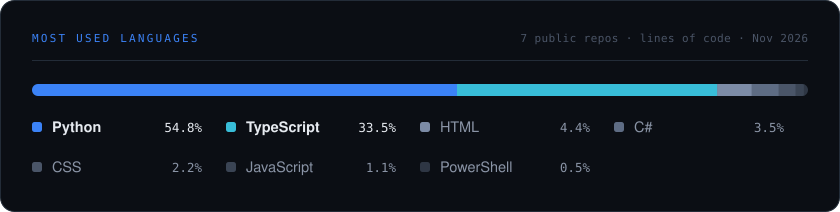</picture>

<picture><source media="(prefers-color-scheme: dark)" srcset="https://streak-stats.demolab.com/?user=hamdulhaq27&amp;background=0B0E14&amp;border=232C38&amp;stroke=232C38&amp;ring=3B82F6&amp;fire=38BDD8&amp;currStreakNum=E6EAF0&amp;sideNums=E6EAF0&amp;currStreakLabel=3B82F6&amp;sideLabels=8A94A6&amp;dates=8A94A6&amp;border_radius=12&amp;date_format=M+j%5B%2C+Y%5D"><source media="(prefers-color-scheme: light)" srcset="https://streak-stats.demolab.com/?user=hamdulhaq27&amp;background=F7F9FC&amp;border=D8DFE9&amp;stroke=D8DFE9&amp;ring=2563EB&amp;fire=0E8FAD&amp;currStreakNum=0E1621&amp;sideNums=0E1621&amp;currStreakLabel=2563EB&amp;sideLabels=566173&amp;dates=566173&amp;border_radius=12&amp;date_format=M+j%5B%2C+Y%5D"></picture>

 

<picture><source media="(prefers-color-scheme: dark)" srcset="assets/decorations/section-08-dark.svg"><source media="(prefers-color-scheme: light)" srcset="assets/decorations/section-08-light.svg"></picture>

<picture><source media="(prefers-color-scheme: dark)" srcset="assets/process/engineering-workflow-dark.svg"><source media="(prefers-color-scheme: light)" srcset="assets/process/engineering-workflow-light.svg">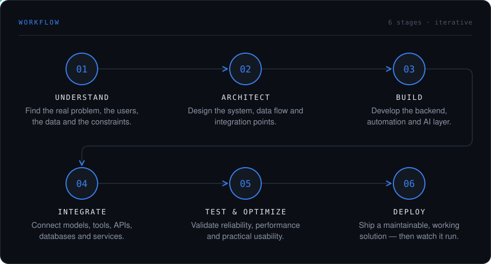</picture>

 

<picture><source media="(prefers-color-scheme: dark)" srcset="assets/decorations/section-09-dark.svg"><source media="(prefers-color-scheme: light)" srcset="assets/decorations/section-09-light.svg"></picture>

<table>
<tr>
<td width="33%" valign="top">

<picture><source media="(prefers-color-scheme: dark)" srcset="assets/focus/agentic-dark.svg"><source media="(prefers-color-scheme: light)" srcset="assets/focus/agentic-light.svg"></picture>

Agents that plan, call tools and recover when a step fails.

</td>
<td width="33%" valign="top">

<picture><source media="(prefers-color-scheme: dark)" srcset="assets/focus/voice-dark.svg"><source media="(prefers-color-scheme: light)" srcset="assets/focus/voice-light.svg">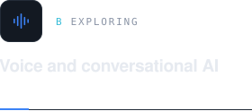</picture>

Faster speech pipelines and better grounding for small, local models, so voice assistants stay quick and accurate on modest hardware.

</td>
<td width="33%" valign="top">

<picture><source media="(prefers-color-scheme: dark)" srcset="assets/focus/mlops-dark.svg"><source media="(prefers-color-scheme: light)" srcset="assets/focus/mlops-light.svg">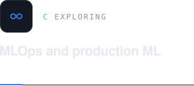</picture>

Scheduling, monitoring and redeploying models reliably.

</td>
</tr>
</table>

 

<picture><source media="(prefers-color-scheme: dark)" srcset="assets/decorations/section-10-dark.svg"><source media="(prefers-color-scheme: light)" srcset="assets/decorations/section-10-light.svg"></picture>

<picture><source media="(prefers-color-scheme: dark)" srcset="assets/decorations/connect-dark.svg"><source media="(prefers-color-scheme: light)" srcset="assets/decorations/connect-light.svg">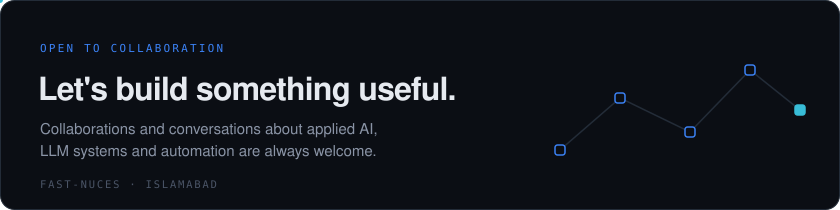</picture>

 

<a href="https://linkedin.com/in/hamdulhaq/"><picture><source media="(prefers-color-scheme: dark)" srcset="assets/buttons/linkedin-dark.svg"><source media="(prefers-color-scheme: light)" srcset="assets/buttons/linkedin-light.svg"></picture></a>&nbsp;
<a href="https://github.com/hamdulhaq27"><picture><source media="(prefers-color-scheme: dark)" srcset="assets/buttons/github-dark.svg"><source media="(prefers-color-scheme: light)" srcset="assets/buttons/github-light.svg"></picture></a>

  

Designed and built from data to deployment · Machine Learning · NLP · Computer Vision · MLOps · Agentic AI

